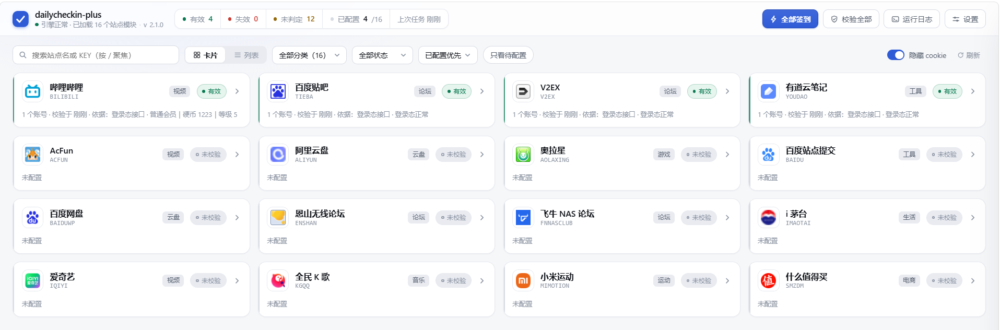

# dailycheckin-plus

跑在 Docker 里的网页签到管理后台：填 cookie、点签到、设定时、看日志，全在浏览器里完成。

内置 16 个站点：百度贴吧、V2EX、NodeSeek、B站（哔哩哔哩）、微博超话、i茅台、阿里云盘等。

[](https://github.com/BeacherZ/dailycheckin-plus/actions/workflows/build.yml)
[](https://github.com/BeacherZ/dailycheckin-plus/pkgs/container/dailycheckin-plus)


签到引擎 fork 自 [Sitoi/dailycheckin](https://github.com/Sitoi/dailycheckin)（MIT）

**2026-10 起由本项目自行维护；网页后台是本项目新增的**。



## 快速开始

两种装法二选一，起好容器用浏览器打开 `http://你的地址:8181`，首次会引导设置后台账号密码。

### 方式一：docker compose

新建 `docker-compose.yml`：

```yaml
services:
  dailycheckin-plus:
    image: ghcr.io/beacherz/dailycheckin-plus:latest
    container_name: dailycheckin-plus
    restart: unless-stopped
    ports:
      - 8181:8080
    volumes:
      - /opt/docker/dailycheckin-plus/config:/dailycheckin-plus/config
      - /opt/docker/dailycheckin-plus/cron:/dailycheckin-plus/cron
      - /opt/docker/dailycheckin-plus/logs:/dailycheckin-plus/logs
      - /opt/docker/dailycheckin-plus/data:/dailycheckin-plus/data
    environment:
      - TZ=Asia/Shanghai
```

**升级**：两行一起粘，任意目录都能跑（第一行问出 compose 在哪，第二行跳过去更新）：

```bash
D=$(docker inspect -f '{{index .Config.Labels "com.docker.compose.project.working_dir"}}' dailycheckin-plus)
cd "$D" && docker compose pull && docker compose up -d
```

### 方式二：docker run

效果同方式一：

```bash
docker run -d --name dailycheckin-plus --restart unless-stopped \
  -p 8181:8080 \
  -e TZ=Asia/Shanghai \
  -v /opt/docker/dailycheckin-plus/config:/dailycheckin-plus/config \
  -v /opt/docker/dailycheckin-plus/cron:/dailycheckin-plus/cron \
  -v /opt/docker/dailycheckin-plus/logs:/dailycheckin-plus/logs \
  -v /opt/docker/dailycheckin-plus/data:/dailycheckin-plus/data \
  ghcr.io/beacherz/dailycheckin-plus:latest
```

**升级**：拉新镜像、删掉旧容器，再把上面那条 `docker run` 原样粘一次（挂载目录不动，数据不会丢）：

```bash
docker pull ghcr.io/beacherz/dailycheckin-plus:latest
docker rm -f dailycheckin-plus
```

Windows 下挂载路径写成 `-v D:/docker/dailycheckin-plus/config:/dailycheckin-plus/config` 这样的形式。

### 数据放在哪

| 目录 | 内容 |
|---|---|
| `config/` | `config.json`，站点与 cookie（与上游格式一致） |
| `cron/` | 定时任务 |
| `logs/` | 签到日志 |
| `data/` | 后台账号、校验状态、运行历史、配置备份 |

删容器不丢数据，备份把这四个目录一起拷走。

## 网页后台

- **站点列表**：卡片一行 4 个（可切列表），官网 LOGO + 状态色条；支持搜索（`/`）、分类筛选、只看待配置，默认「已配置优先」，跟随系统深浅色。
- **配置站点**：点卡片开窗，含「怎么拿 cookie」的说明与账号表单，底栏固定「＋ 添加账号 / 立即签到 / 保存」。每个账号可填备注，通知里的「账号信息」优先用站点返回的用户名，拿不到就用它；百度网盘、恩山、飞牛、阿里云盘这四个站点取不到用户 ID，面板会提示必须填备注。
- **cookie 随便粘**：分号串、换行分隔、DevTools 表格、JSON 导出、`Cookie:` 前缀的 curl 命令都认，自动规范化 —— 引擎写死 `; ` 分隔，格式不对会静默解析错。
- **cookie 有效性**：格式体检 → 在线校验（拿昵称 / 等级 / 余额）→ 运行校验，结论存卡片徽章，改 cookie 后旧结论立即作废；网络问题只报「无法判定」。
- **跑签到**：单站跑或「全部签到」，输出实时显示在抽屉里（当前 / 历史 / 日志）。
- **定时签到 / 定时校验**：设置页选预设或填 cron，保存即生效。校验默认每 6 小时，只查已配置且有在线接口的站点；**全部有效静默**，有失效才推一条【dailycheckin-plus 校验提醒】，同批失效 24 小时内不重复。
- **推送通知**：沿用上游全部渠道（PushPlus、企业微信、Telegram、Bark、钉钉、飞书、Gotify、ntfy、Server 酱、Qmsg），只填要用的。

```text
【dailycheckin-plus 每日签到】

「AcFun」
账号信息: ABC
签到信息: 今日已签到
————————
「AcFun」
账号信息: DEF
签到信息: 今日已签到
————————————————
「V2EX 论坛」
账号信息: ABC
今日签到: 20261016 的每日登录奖励 13 铜币
————————————————
任务用时: 1 秒
项目地址: https://github.com/beacherz/dailycheckin-plus
```

## 支持的站点

清单从引擎里自动发现，加个目录就出现。当前 16 个：

| 站点 | KEY | 凭据（必填） |
|---|---|---|
| 哔哩哔哩 | `BILIBILI` | Cookie `SESSDATA`、`bili_jct` |
| 百度贴吧 | `TIEBA` | Cookie `BDUSS` |
| 百度网盘 | `BAIDUWP` | Cookie `BDUSS` |
| 爱奇艺 | `IQIYI` | Cookie `P00001` |
| 有道云笔记 | `YOUDAO` | Cookie `YNOTE_PERS` |
| V2EX | `V2EX` | Cookie `A2` |
| 什么值得买 | `SMZDM` | 建议整块复制 |
| 恩山无线论坛 | `ENSHAN` | Cookie `TWcq_2132_auth` |
| 飞牛 NAS 论坛 | `FNNASCLUB` | Cookie `pvRK_2132_auth` |
| NodeSeek | `NODESEEK` | Cookie `session` |
| 全民 K 歌 | `KGQQ` | Cookie `uid`、`openid`、`openkey` |
| 微博超话 | `WEIBO` | Cookie `SUB` |
| 阿里云盘 | `ALIYUN` | refresh_token |
| i 茅台 | `IMAOTAI` | `token`、`userid`、`mobile` 等 |
| AcFun | `ACFUN` | Cookie `acPasstoken`、`auth_key`（约一个月有效） |
| 小米运动 | `MIMOTION` | 账号密码 |

微博超话默认签全部关注（上限 20 个，可调），也可填逗号分隔的超话名；名字精确匹配 —— 配「周杰伦」不会顺带签「周杰伦电影速报」。

没写元数据的站点开箱可用，只是不拦必填、没有在线校验、LOGO 退回图标。

**怎么拿 cookie**：登录目标站 → `F12` → Application → Cookies → 选中域名 `Ctrl+A` `Ctrl+C`；或用 [Cookie-Editor](https://chromewebstore.google.com/detail/cookie-editor/hlkenndednhfkekhgcdicdfddnkalmdm) 的 **Export → JSON** 整块贴进来。cookie 等于账号密码，别外发 —— 只存在你本机的 `config/config.json`。

## 环境变量

| 变量 | 默认 | 说明 |
|---|---|---|
| `TZ` | `Asia/Shanghai` | 时区，影响定时任务时间 |
| `PANEL_PORT` | `8080` | 容器内监听端口（改这个要同步改 `-p` 映射） |
| `PANEL_TITLE` | `dailycheckin-plus` | 浏览器标签 + 顶栏的品牌名 |
| `PANEL_USERNAME` / `PANEL_PASSWORD` | 空 | 想跳过「首次打开手动设账号」时填，只在后台还没初始化时生效 |
| `PANEL_TOKEN` | 空 | 可选的脚本口令，给 curl / 自动化用（`X-Panel-Token` 头或 `?token=`），**不能替代登录**，别开在公网 |
| `PANEL_RUN_TIMEOUT` | `1800` | 单次签到任务超时秒数 |
| `PANEL_REPO` | `BeacherZ/dailycheckin-plus` | 「关于本项目」的链接与检查更新的比对对象，换成自己的 fork 即可 |
| `PANEL_GH_TOKEN` | 空 | 访问 GitHub 接口时带上，避免匿名限流（60 次/小时/IP） |
| `DC_HOME` | `/dailycheckin-plus` | 工作目录，一般不用改 |

纯标准库实现，**零框架依赖**，x86 / arm64 / armv7 都能跑；后台密码只存 PBKDF2 派生值 + 随机盐，会话是签名票据（重启不掉线），登录失败按 IP 限速。

## 引擎维护

引擎源码内置在 `dailycheckin_plus/`（不从 PyPI 装），直接改、直接提交。**2026-10-19 起与上游脱钩**：上游最近一次实质更新是 2025-12、站点修复停在 2025-10，同步拿不到东西。`UPSTREAM.json` 保留 fork 来源，设置页「环境信息」可见。

加一个站点，四处：`dailycheckin_plus/<站点>/`（空 `__init__.py` + `main.py`，`class Xxx(CheckIn)`，实现 `main()` 返回分行文本，引擎自动发现）；`panel/catalog.py` 补元数据；`panel/verify.py` 写在线校验；`tools/test_<站点>.py` 并接进 CI。

离线自测不用网络，CI 每次构建都跑：`test_sites` · `test_nodeseek` · `test_weibo` · `test_notice` · `test_schedule` · `test_panel_static` · `test_autoverify` · `test_verify` · `test_version`

```bash
for t in tools/test_*.py; do python "$t" || break; done
```

## 常见问题

**挂公网？** 登录后台设好密码，前面套 HTTPS 反向代理（会话票据是 Bearer 语义），记得转发 `X-Forwarded-Proto`。

**从 `sitoi/dailycheckin` 迁过来？** 先 `docker stop dailycheckin && docker rm dailycheckin`（上游镜像的容器名就叫 `dailycheckin`，不删会和本项目的 `dailycheckin-plus` 抢 8181 端口、还会重复签到），把 `config/config.json` 拷进本项目 `config/`，再起容器。

**校验显示「无法判定」是 cookie 坏了吗？** 不一定，网络不通、接口改版、风控都会这样（被 Cloudflare 拦时也会落到这里，但那跟 cookie 无关）。点「立即签到」：报错了一定有问题，没报错也不能证明有效。

**怎么知道要不要更新？** 设置页最下方「关于本项目」就两行：当前版本 / 最新版本。最新的那个比自己大才需要更新，数字变橙就是有新版。

**在 root 目录跑更新报 `no configuration file provided`？** compose 只认当前目录的 `docker-compose.yml`，用上面「升级」那两行，或 `docker compose ls` 查项目路径。

## 本地开发

```bash
pip install -r requirements.txt    # 只有引擎需要（requests / pycryptodome / rsa / urllib3）
python -m panel                    # 默认 0.0.0.0:8080
```

引擎导入失败面板也能起来并给出提示，不会白屏。从源码构建镜像：`docker compose -f docker-compose.build.yml up -d --build`。
目录：`panel/` 后台（纯标准库）、`dailycheckin_plus/` 引擎、`tools/` 离线自测、`docker/entrypoint.sh` 入口。

## 致谢与许可

引擎、cookie 抓取方式与绝大部分站点模块都来自 [Sitoi/dailycheckin](https://github.com/Sitoi/dailycheckin)（作者 **Sitoi**）及其[贡献者](https://github.com/Sitoi/dailycheckin/graphs/contributors)的劳动，感谢他们长期免费维护。

本项目新增的是网页后台、Cookie 规范化与在线校验、定时任务托管、通知单条化、Docker 编排，以及 NodeSeek、微博超话两个站点。

引擎虽已自行维护，**版权仍归原作者**，`LICENSE` 里的 MIT 声明原样保留。
